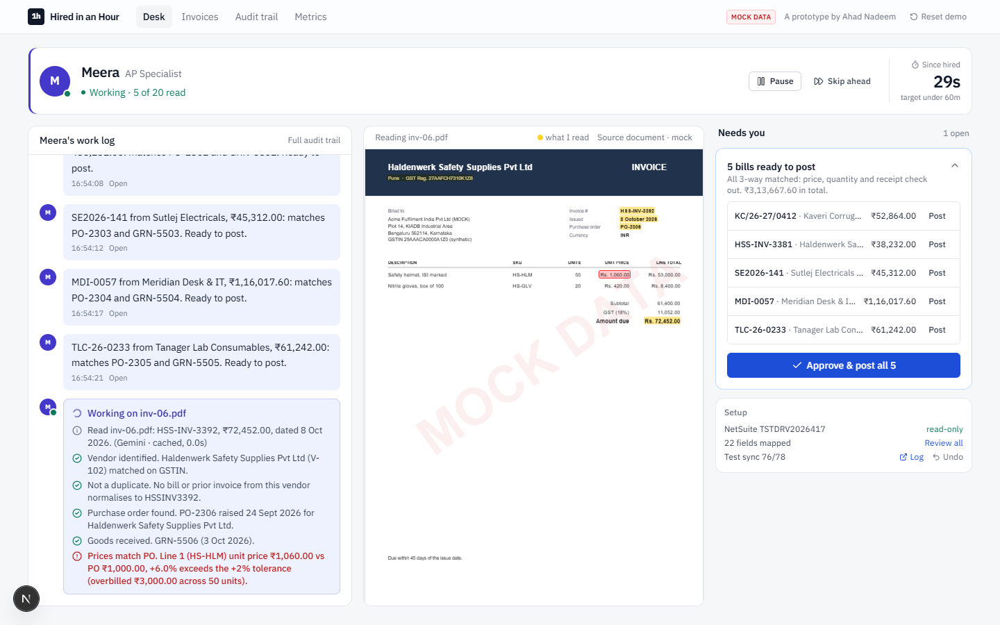
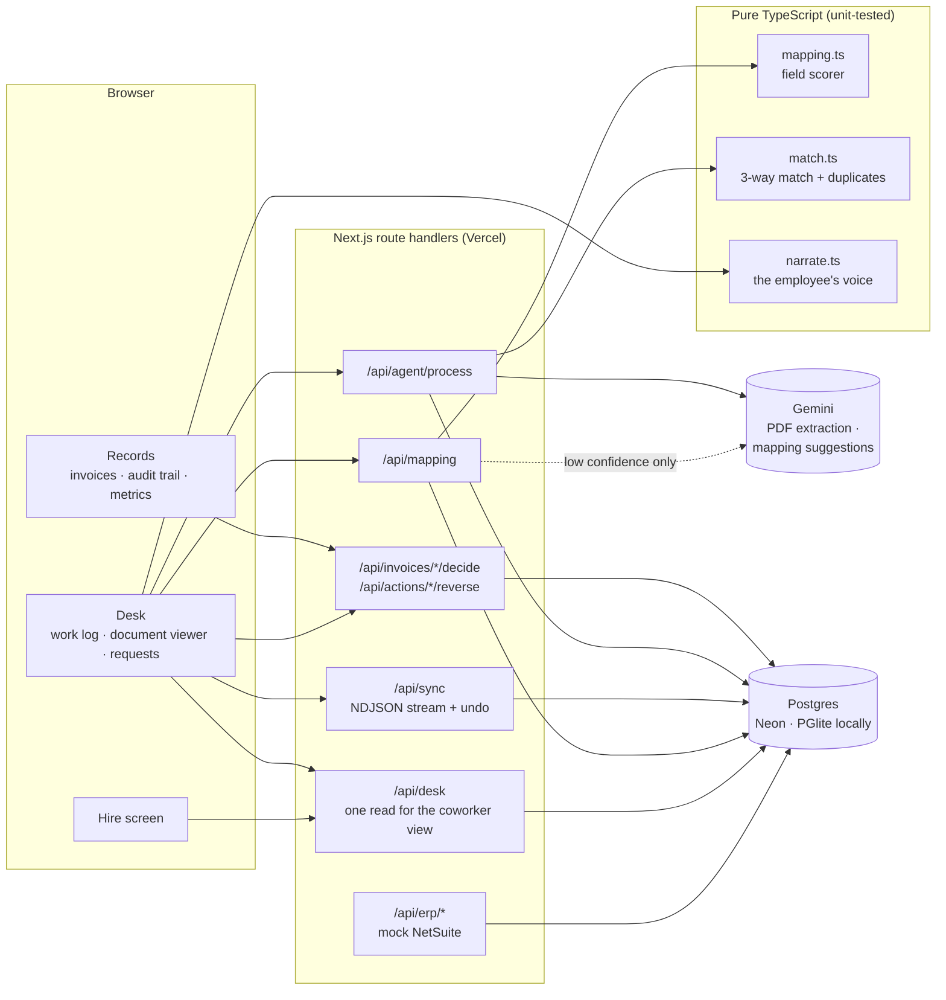

# Hired in an Hour

**Hire an AI accounts-payable employee, watch it onboard itself, and have it posting supervised bills within the hour.**

**Live demo:** https://zamp-in-an-hour.vercel.app · **Design decisions:** [DECISIONS.md](DECISIONS.md)

> **All data is synthetic.** The vendors, invoices, purchase orders, goods receipts and the NetSuite sandbox are generated for this demo. There is no real ERP connection and no real company or customer data.



---

## Why

An AI employee creates no value until it is **connected** to your ERP, **understands** your fields, and you **trust** it enough to let it act. In practice each of those steps becomes a meeting, a spreadsheet and a week of implementation calls.

This prototype compresses all three into one guided hour and measures it with a single number:

> **Time from hire to the first bill the employee posts with your approval.** Target: under 60 minutes, managed at p90.

The definition, its edge cases and what it deliberately doesn't capture are in [DECISIONS.md §1](DECISIONS.md#1-the-metric).

## What it does

You hire a coworker. It onboards itself, asks you only what it can't work out, then gets to work while you watch.

| | What you see | What's underneath |
|---|---|---|
| **1. Hire** | You name your new AP employee. The clock starts. | One isolated workspace per visitor. |
| **2. Access** | It asks for read-only NetSuite access. | A faithful mock of NetSuite's record API (`/api/erp/{record}`). |
| **3. Three questions** | It maps 19 of 22 fields itself and asks you about the 3 custom fields it can't be sure of, in its own words. | Rules first (name, value format, cross-record references); Gemini only for what rules can't verify; a model suggestion never approves itself. |
| **4. Test sync** | It runs the sync unprompted: 76 of 78 records in, 2 old bills set aside with the reason. Undo any time. | Your mapping applied and validated per record; failures quarantined, not dropped. |
| **5. Work** | One invoice at a time, it narrates each check and highlights on the PDF exactly where it read each value. | Gemini reads the PDF; a deterministic engine does the 3-way match against PO and goods receipt. |
| **6. Decisions** | Matched bills arrive as one batch. Each exception arrives as a card with the evidence, the rule it broke, and a drafted query to the vendor. | Supervised mode: nothing is written to the ERP without your approval. |
| **7. First bill** | You approve; it posts the bill; the clock stops. | Every action is in an append-only audit trail and can be reversed with a compensating entry. |

### The four exceptions it catches

| Invoice | Exception | What the employee says |
|---|---|---|
| `inv-06` | Price above PO | Line 1 unit price ₹1,060 vs PO-2306 ₹1,000: +6.0%, over the 2% tolerance |
| `inv-11` | No goods receipt | No item receipt in NetSuite references PO-2311 |
| `inv-17` | Duplicate | `MDI42` normalises to `MDI-0042`, already paid, same total |
| `inv-19` | Billed more than received | Billed 120, received 100: 20 units unreceived |

Plus one invoice 1.2% over the PO that **passes with a warning**, because within tolerance isn't an exception.

### A two-minute tour

Hire and name it (10s) → grant access and answer its three questions (25s) → watch it read and stop on the ₹1,060 overbilling, PDF highlighted (40s) → hold with its drafted query, approve a bill, clock stops (25s) → audit trail and metrics (20s).

## Principles

- **Real work, synthetic data.** Gemini reads actual PDF bytes in three different layouts; the match engine is real, tested code. Only the data is invented.
- **Every AI result is labelled** *live*, *cached* or *precomputed fallback*, with its real read time. The demo works without an API key and never passes off a fallback as AI.
- **Narration paces the display, never the work.** Each check is shown for ~0.3s so a person can follow it; a live Gemini read shows "Reading…" for as long as it actually takes. Skip-ahead still runs every check.
- **Evidence, not vibes.** Every exception names the document, field and value on both sides and the rule it broke.
- **Supervised first, autonomy earned.** Nothing posts without approval; every action is reversible and audited; undo and reversal rates are tracked as trust signals.
- **Honest measurement.** One session per workspace, so abandoned runs count as drop-off; rehearsal sessions (`?internal=1`) are excluded from the metrics.

## Architecture



- **The employee's voice is derived, not invented.** `narrate.ts` turns real audit records and match results into first-person lines; the work log is rebuilt from the audit trail, so it survives a refresh.
- **The document viewer** renders the PDF with pdf.js and highlights the extraction's own evidence quotes and the values cited by failed checks.
- **Workspaces:** each browser gets an isolated workspace via cookie (no auth). "Reset demo" starts a new one.

## Stack

Next.js 16 (App Router) · TypeScript · Tailwind CSS 4 · Postgres (Neon in production, PGlite locally) · Google Gemini · pdf.js · pdf-lib · Vitest · Playwright. Reasons for each are in [DECISIONS.md §17](DECISIONS.md#17-stack).

## Run it locally

Requires **Node 20.19+** (22 LTS recommended).

```bash
npm install
npm run dev          # http://localhost:3000 — no database or API key needed
```

- **No `DATABASE_URL`:** an in-process Postgres (PGlite) is created in `.data/`.
- **No `GEMINI_API_KEY`:** extraction and mapping suggestions come from the committed snapshot of real Gemini answers (labelled *cached*), or from precomputed answers (labelled *fallback*).

Optional `.env.local` (never committed):

```bash
GEMINI_API_KEY=...            # live extraction and mapping suggestions
GEMINI_MODEL=gemini-3.5-flash # override the model
DATABASE_URL=postgres://...   # Neon or any Postgres
```

### Scripts

```bash
npm test              # unit tests: match engine, mapping scorer, narration (42 tests)
npm run e2e           # browser tests in installed Chrome: happy path + exception path, fresh in-memory DB
E2E_BASE_URL=https://zamp-in-an-hour.vercel.app npm run e2e   # the same tests against the live site
npm run pdfs          # regenerate the 20 synthetic invoice PDFs from src/data/seed.ts
npm run cache:export  # snapshot live Gemini answers from the local DB (stop the dev server first)
```

Regenerating the PDFs changes their fingerprints, so the cached Gemini reads no longer match them until they're read live again and re-exported.

Add `?internal=1` to any URL once to mark your browser as a rehearsal session.

### Deploy

Import the repo into Vercel, add a Neon Postgres database (its prefix must produce `DATABASE_URL`), and set `GEMINI_API_KEY` as a sensitive environment variable. On first start, each new database loads the Gemini snapshot.

## Repo map

```
src/app/page.tsx              hire screen
src/app/desk/                 the desk: the coworker view
src/components/desk/          work log, document viewer, request cards, the useDesk conductor
src/lib/narrate.ts            the employee's voice (pure, unit-tested)
src/lib/match.ts              3-way match, duplicate detection, citations
src/lib/mapping.ts            deterministic field-mapping scorer
src/lib/llm.ts                Gemini calls: cache, rate limits, retries, labelled fallback
src/lib/service.ts            onboarding, sync, agent pipeline, decisions, reversal
src/lib/audit.ts              append-only action log and funnel events
src/data/seed.ts              synthetic vendors, POs, receipts, bills, invoices (deterministic)
src/data/gemini-cache.json    real Gemini answers for the 20 invoices and 3 mapping questions
scripts/generate-pdfs.ts      three invoice layouts → public/mock-invoices/*.pdf
e2e/                          Playwright browser tests
```

## What's deliberately out of scope

Multi-ERP, a real ERP connection, auth/SSO/billing, email ingestion and sending, configurable tolerances, mobile, dark mode and multi-currency. The reasoning for each is in [DECISIONS.md §18](DECISIONS.md#18-what-i-cut-and-why).

---

Built by Ahad Nadeem.
