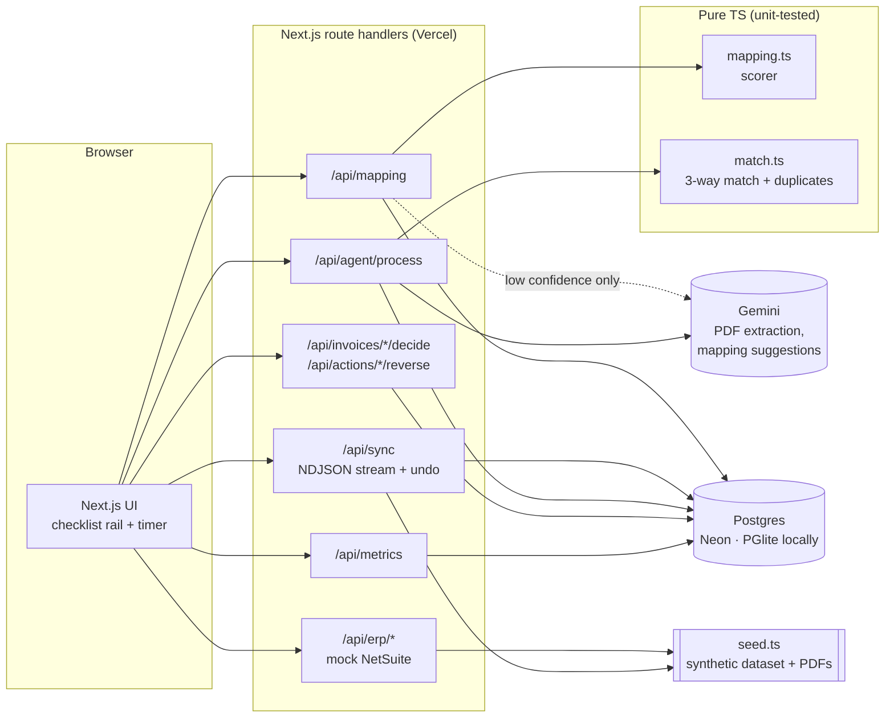

# Zamp in an Hour

**A prototype that takes a finance team from zero to a working AP digital employee in under an hour, and measures it.**

> ⚠️ **All data is synthetic mock data.** The vendors, invoices, POs, receipts and the NetSuite sandbox are generated for this demo. There is no real ERP connection, no customer data and no Zamp data. This is an independent prototype by Ahad Nadeem, not a Zamp product.

**Live demo:** https://zamp-in-an-hour.vercel.app · **Decisions log:** [DECISIONS.md](DECISIONS.md)

---

## The problem

A digital employee is only valuable once it's **connected** to the ERP, its fields are **mapped**, and the finance team **trusts** it enough to let it act. Each of those steps tends to become a meeting, a spreadsheet and a week. Every week of setup is a week the customer pays without seeing value, and it caps how many customers an implementation team can bring live.

## The metric

**Time to first working digital employee.** Target: **< 60 minutes**, managed at p90.

Measured from **hiring the employee** to the **first vendor bill the AP employee posts after a passed 3-way match and a human approval**. The definition, edge cases and what it deliberately doesn't capture are in [DECISIONS.md §1](DECISIONS.md#1-the-metric).

## The flow: you hire a coworker, it onboards itself

| Step | What you see | The real logic underneath |
|---|---|---|
| 1. Hire | You name your new AP employee; the clock starts | Workspace per visitor; the name is stored and used everywhere |
| 2. Access | It asks for read-only NetSuite access | Faithful mock of NetSuite's record API (`/api/erp/{record}`) |
| 3. Three questions | It maps 19 of 22 fields itself and asks you about the 3 it can't be sure of, in its own words | Name + value-format + **referential** scoring; Gemini only for what rules can't verify; an LLM suggestion never auto-approves |
| 4. Test sync | It runs the sync on its own: 76 of 78 in, 2 old bills set aside with reasons; undo any time | Mapping applied and required fields validated per record |
| 5. It works | One invoice at a time, it narrates each check and highlights on the PDF where it read each value | Gemini PDF extraction → deterministic 3-way match (28 unit tests) |
| 6. It brings you decisions | 16 matched bills in one batch; each exception as a card with citation, rule and a drafted vendor query | Supervised mode: nothing is written without approval |
| 7. First bill | You approve; it posts the bill and the clock stops | Compensating reversal for every action; append-only audit trail |

**The 2-minute demo:** hire and name it (10s) → grant access and answer its 3 questions (25s) → watch it read and stop on the ₹1,060 vs ₹1,000 overbilling, PDF highlighted (40s) → hold with its drafted query, approve a bill, clock stops (25s) → audit trail and metric (20s).

**Seeded exceptions**, each caught with a cited reason (document, field, value, rule):

| Invoice | Exception | What the employee says |
|---|---|---|
| `inv-06` | Price mismatch | Line 1 unit price ₹1,060 vs PO-2306 ₹1,000, +6.0% > 2% tolerance |
| `inv-11` | Missing receipt | No item receipt in NetSuite references PO-2311 |
| `inv-17` | Duplicate | `MDI42` normalises to the same number as paid bill `MDI-0042`, same total |
| `inv-19` | Quantity variance | Billed 120, received 100; 20 units unreceived |

Plus one +1.2% price variance that **passes with a warning**: within tolerance means no exception.

**Trust layer:** every action (agent or human) is in an append-only audit trail with evidence and before/after state. Posted bills, holds, rejections, mapping decisions and syncs can be **reversed** with a compensating entry.

**Measurement:** a live timer on every screen, plus a funnel (step conversion, median time per step, drop-off), p50/p90 time-to-first-employee and undo/reversal rates. Sessions come from real demo visitors, with rehearsals excluded.

## Architecture



- **Every LLM result is labelled** *live*, *cached* or *precomputed fallback*, so the demo works without a key and never passes off a fallback as AI.
- **Workspaces:** each browser gets an isolated workspace via cookie (no auth, deliberately cut). "Reset demo" starts a new one.

## What I cut, and why

Multi-ERP, real ERP connection, auth/SSO/billing, email ingestion, outbound vendor emails, a tolerance-configuration UI, mobile, dark mode, multi-currency. None of them move the onboarding-time number for the first customer. Reasons for each are in [DECISIONS.md §18](DECISIONS.md#18-what-i-cut-and-why).

## Run it locally

Requires **Node 20.19+** (22 LTS recommended).

```bash
npm install
npm run dev          # http://localhost:3000. No database or API key needed.
```

- **No `DATABASE_URL`** → an in-process Postgres (PGlite) is created in `.data/`.
- **No `GEMINI_API_KEY`** → extraction and mapping suggestions use precomputed answers, labelled as such.
- **Real Gemini answers ship with the repo** (`src/data/gemini-cache.json`): every fresh database loads them as *cached*, so the demo shows genuine model reads even on Gemini's free tier (20 requests/day). See [DECISIONS.md §15](DECISIONS.md#15-llm-reliability-live-cached-or-fallback-always-labelled).

Optional `.env.local`:

```bash
GEMINI_API_KEY=...            # live extraction + mapping suggestions
GEMINI_MODEL=gemini-3.5-flash # override the model
DATABASE_URL=postgres://...   # Neon / any Postgres
```

Other scripts:

```bash
npm test        # unit tests: match engine + mapping scorer
npm run e2e     # browser tests (installed Chrome): happy path + price-mismatch path, on a fresh in-memory DB
E2E_BASE_URL=https://zamp-in-an-hour.vercel.app npm run e2e   # same tests against the live site
npm run pdfs    # regenerate the 20 synthetic invoice PDFs from src/data/seed.ts
npm run cache:export  # snapshot live Gemini answers from the local DB (stop the dev server first)
```

Add `?internal=1` to any URL once to mark your browser as a rehearsal session (excluded from metrics).

## Repo map

```
src/data/seed.ts          synthetic vendors, POs, receipts, bills, invoices (deterministic)
scripts/generate-pdfs.ts  3 invoice layouts → public/mock-invoices/*.pdf
src/lib/mapping.ts        deterministic field-mapping scorer
src/lib/match.ts          3-way match, duplicate detection, citations
src/lib/llm.ts            Gemini calls with cache / rate limit / labelled fallback
src/lib/service.ts        sync, agent pipeline, decisions, reversal
src/lib/audit.ts          append-only action log + funnel events
src/app/                  screens and API routes
```
